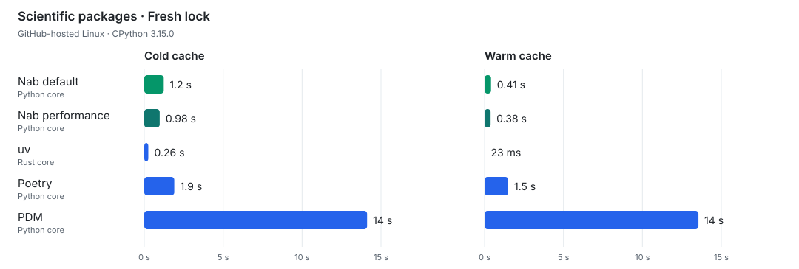
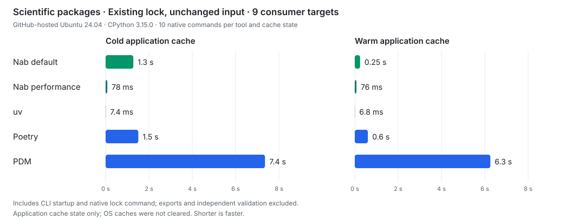

# nab

nab generates universal lockfiles for Python projects. Declare your target Python versions and
platforms in `pyproject.toml`, then write one PEP 751 `pylock.toml` covering them. An installer such
as pip installs the dependencies selected for its environment from that file.

nab is written in Python and is experimental. It resolves dependencies and can download artifacts;
it does not install packages or manage virtual environments.

[Documentation](https://nab.readthedocs.io/en/stable/) ·
[What nab locks](https://nab.readthedocs.io/en/stable/explanation/locking.html) ·
[First universal lock](https://nab.readthedocs.io/en/stable/tutorial/getting-started.html)

## Install

```bash
pipx install nab
nab --version
```

Or install with uv:

```bash
uv tool install nab
```

nab runs on CPython 3.10 and newer. See
[installation options](https://nab.readthedocs.io/en/stable/how-to/install.html).

## Example project

Save this as `pyproject.toml` in a new directory:

```toml
[project]
name = "example"
version = "0.1.0"
requires-python = ">=3.12,<3.16"
dependencies = ["requests>=2,<3"]

[tool.nab.matrix]
python = ">=3.12,<3.16"
platforms = ["linux_x86_64", "macos_arm64"]
```

Generate the lock:

```bash
nab lock pyproject.toml
```

Or use `uvx nab lock pyproject.toml` without installing nab first. This writes one lock for Python
3.12, 3.13, 3.14 and 3.15 on Linux x86-64 and Apple Silicon macOS.

Install from it in a covered virtual environment with pip 26.1 or newer:

```bash
python -m pip install -r pylock.toml
```

In nab, you choose which Python versions, platforms and interpreter implementations to resolve
universally, because explicit is better than implicit. See the
[tutorial](https://nab.readthedocs.io/en/stable/tutorial/getting-started.html) for a walkthrough and
[target configuration](https://nab.readthedocs.io/en/stable/reference/target-matrix.html) for other
targets.

## Safer defaults

[pip](https://pip.pypa.io/en/stable/reference/build-system/#metadata-generation) and
[uv](https://docs.astral.sh/uv/reference/settings/#no-build) can run a downloaded package's build
backend just to discover its dependencies. nab makes remote builds opt-in, reducing code execution
during locking.

- Universal locking runs no build backends. Host-specific locking allows local project builds;
  remote builds need explicit permission, which you can limit to one package or index. See
  [build policy](https://nab.readthedocs.io/en/stable/reference/build-policy.html).
- Git sources are blocked until you allow them. Opting in requires allowed schemes and repository
  prefixes, with full commit pins required by default. See
  [Git sources](https://nab.readthedocs.io/en/stable/how-to/vcs.html).
- Direct archive sources require a hash, verified before reading metadata. See
  [archive sources](https://nab.readthedocs.io/en/stable/how-to/archive-sources.html).

These controls apply during locking; your installer may still build a locked source distribution.

## Soundness

By default, Nab checks dependencies and artifact compatibility for every environment you declare.

- Nab uses each target's preferred wheel metadata; uv
  [assumes consistent metadata across a release's wheels](https://docs.astral.sh/uv/reference/internals/resolver/#metadata-consistency).
- Nab retains dependency `Requires-Python` upper bounds at Python-minor granularity, including
  bounds
  [uv deliberately ignores](https://docs.astral.sh/uv/reference/internals/resolver/#requires-python).
- Nab derives yank permission from active exact pins, including selected transitive pins. Rejected
  parent versions cannot leave permission behind; uv
  [builds its allowlist from initial inputs and locked versions](https://github.com/astral-sh/uv/blob/0.13.4/crates/uv-resolver/src/yanks.rs).
  See [Nab's policy](https://nab.readthedocs.io/en/stable/reference/yanking.html) and the
  [spec](https://packaging.python.org/en/latest/specifications/file-yanking/).

## More features

Use [requirements and markers](https://nab.readthedocs.io/en/stable/how-to/choose-dependencies.html)
to select dependencies by environment, and extras or groups for optional sets. Nab also supports
scoped policies and metadata overrides, multiple indexes, workspaces, pinned Git sources and hashed
archives. [Browse the guides](https://nab.readthedocs.io/en/stable/how-to/index.html) for these
workflows.

## Policy overrides

Nab uses dependency requirements to select which releases a policy overrides.

### Allow a reviewed update during a cooldown

Keep a seven-day cooldown, with an exception for reviewed files of `certifi` 2026.10.19:

```toml
[tool.nab]
uploaded-prior-to = "P7D"

[tool.nab.packages."certifi==2026.10.19"]
uploaded-prior-to = "2026-10-20T02:24:17Z"
```

The fixed cutoff excludes later uploads of the same version. Other versions keep the global
cooldown.

### Use an index without upload times

Disable the cutoff only for an internal index that does not publish upload times:

```toml
[tool.nab]
uploaded-prior-to = "P7D"

[[tool.nab.indexes]]
name = "pypi"
url = "https://pypi.org/simple/"

[[tool.nab.indexes]]
name = "internal"
url = "https://packages.example.com/simple/"

[tool.nab.index.internal]
uploaded-prior-to = false
```

See
[package and index policies](https://nab.readthedocs.io/en/stable/reference/package-policy.html).

## Performance

Nab checks each target's wheel metadata and honors Python upper bounds by default. These checks can
catch incompatible dependencies that uv's [optimizations](#soundness) may miss.

Nab resolves afresh to check for package changes. Decision order defaults to `stable`, so HTTP
response timing does not steer pin choices.

Configure these options in `nab.toml` beside `pyproject.toml`:

| Option                              | Behavior and tradeoff                                                          |
| ----------------------------------- | ------------------------------------------------------------------------------ |
| `lock-policy = "resolve"` (default) | Resolve afresh using current package information.                              |
| `lock-policy = "prefer-existing"`   | Prefer saved versions when still valid; may keep older releases.               |
| `lock-policy = "reuse"`             | Reuse a valid saved lock without checking for remote updates.                  |
| `decision-order = "arrival"`        | Reduce HTTP waits by processing listings as they arrive; pin choices may vary. |
| `assume-consistent-metadata = true` | Reuse wheel metadata across targets, assuming a release's wheels agree.        |

`reuse` is close to
[uv's default behavior for an unchanged project](https://docs.astral.sh/uv/concepts/projects/sync/#checking-the-lockfile):
keep the existing lock without looking for package updates.

See [distribution policies](docs/reference/distribution-policy.md) and
[lock policies](docs/reference/cli.md) for configuration and restrictions.

## Universal lock benchmark

Cold and warm cache timings compare Nab's default and performance settings with uv, Poetry and PDM.

Creating a fresh lock for NumPy, pandas, SciPy, Matplotlib and scikit-learn:

<p align="center">
  <picture>
    <source media="(prefers-color-scheme: light)" srcset="docs/_static/universal-lock-scientific9-light.svg">
    <source media="(prefers-color-scheme: dark)" srcset="docs/_static/universal-lock-scientific9-dark.svg">
    
  </picture>
</p>

Relocking NumPy, pandas, SciPy, Matplotlib and scikit-learn with unchanged inputs. Saved-lock reuse
can be a no-op:

<p align="center">
  <picture>
    <source media="(prefers-color-scheme: light)" srcset="docs/_static/universal-lock-relock-scientific9-light.svg">
    <source media="(prefers-color-scheme: dark)" srcset="docs/_static/universal-lock-relock-scientific9-dark.svg">
    
  </picture>
</p>

Nab performance uses these settings in `nab.toml`:

```toml
http-backend = "httpx2"
decision-order = "arrival"
dist-policy = "wheel-only"
metadata-policy = "prefer-wheel"
assume-consistent-metadata = true
max-concurrency = 50
```

Existing-lock runs also set `lock-policy = "reuse"`. `wheel-only` considers prebuilt wheels and
excludes source distributions. The concurrency limit lets the client overlap more waiting HTTP
requests. Higher concurrency can use more connections and memory. These settings can be slower when
dependencies change.

## Libraries

nab also publishes components for other tools:

- `nab-resolver`: a generic PubGrub resolver with stable public module paths.
- `nab-markersets`: PEP 508 marker algebra.
- `nab-provider`: Python packaging policy and resolution logic without I/O.
- `nab-index`: package-index and source clients with caching.
- `nab-project`: resolve orchestration, lockfiles and downloads.

The other component APIs are experimental. See
[how the packages fit together](https://nab.readthedocs.io/en/stable/explanation/packages.html) and
the [CLI walkthrough](src/nab/_cli/README.md) to explore the code.
