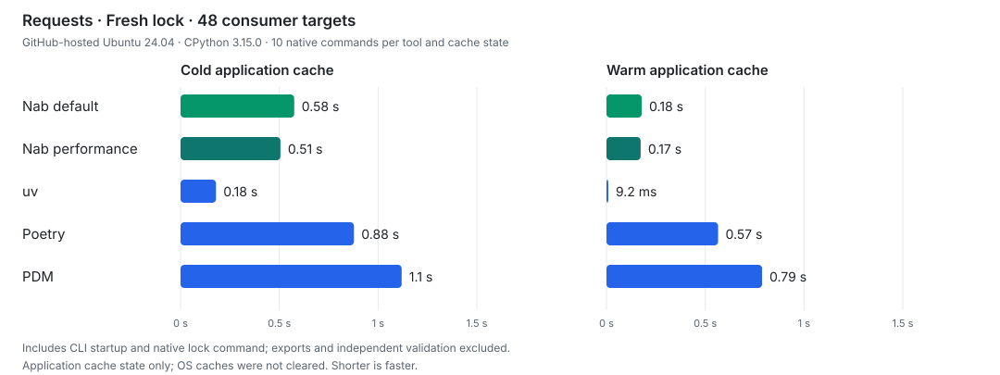

# README benchmark inputs

The README figures were measured on November 7, 2026 using Nab
`f3c05aa4c679e2b637500536c4f9053b7820b851`, uv 0.13.7, Poetry 2.5.1 and PDM 2.29.6. Nab, Poetry and
PDM ran as ordinary installed Python wheels on CPython 3.15.0 with the GIL enabled, on GitHub-hosted
Ubuntu 24.04. Project interpreter selection used Python 3.12.13 before the timed command.

## Settings and measured projects

The two Nab rows use the same installed Nab wheels and ordinary per-target resolution. Nab default
uses the defaults. Nab performance uses `nab lock --http-backend httpx2` with this configuration,
adding `--lock-policy reuse` for existing-lock runs:

```toml
[tool.nab]
dist-policy = { policy = "wheel-only", trust-unverified-deps = true }
assume-consistent-metadata = true
assume-universal-deps = true
metadata-policy = "prefer-wheel"
```

Concurrency stays at the default of eight. Wheel-only excludes releases without a usable wheel; it
can fail where the default could use a source distribution. `assume-universal-deps` and
`trust-unverified-deps` do not affect these wheel-only selections. The bundle does not speed up
every task: adding `six==1.17.0` to the Requests lock took between about 4% and 12% longer with warm
caches, with a middle estimate near 7.5% (99% interval).

The fresh scientific project pins NumPy 2.1.3, pandas 2.2.3, SciPy 1.14.1, Matplotlib 3.9.2 and
scikit-learn 1.5.2. Its nine consumer targets cover CPython 3.10 to 3.12 on Linux x86-64, Apple
Silicon macOS and Windows x86-64. The unchanged scientific relock restores an existing lock with the
same inputs.

All tools receive the same root requirements and Python range. Nab declares the finite consumer
matrix; the other tools use their normal native universal locking behavior. Every tool's selected
dependencies and wheel metadata were independently checked on those consumer targets.

## Requests fresh lock

Fresh locks for `requests==2.32.3`, checked on 48 consumer targets: Python 3.12 to 3.14, eight
platforms and CPython/PyPy.

<p align="center">
  <picture>
    <source media="(prefers-color-scheme: light)" srcset="../../../docs/_static/universal-lock-benchmark-light.svg">
    <source media="(prefers-color-scheme: dark)" srcset="../../../docs/_static/universal-lock-benchmark-dark.svg">
    
  </picture>
</p>

## Jupyter conditional-dependency check

Copy [jupyter.toml](jupyter.toml) to `pyproject.toml` in a separate directory for each tool. It pins
`jupyter==1.1.1` and `python-dateutil==2.9.0.post0`. Its Python range is `>=3.12,<3.15`; Nab's
consumer matrix is CPython 3.12, 3.13 and 3.14 on Linux x86-64, Apple Silicon macOS and Windows
x86-64.

Select the project interpreter before running these native commands. Remove the tool's existing lock
for a fresh-lock check:

| Row             | Native command                                 |
| --------------- | ---------------------------------------------- |
| Nab default     | `nab --no-progress lock`                       |
| Nab performance | `nab --no-progress lock --http-backend httpx2` |
| uv              | `uv lock`                                      |
| Poetry          | `poetry lock --no-interaction`                 |
| PDM             | `pdm lock --prod`                              |

For Nab performance, add the configuration above. Both Nab rows use ordinary target-by-target
checks. uv uses its normal universal strategy, without an `environments` or `fork-strategy`
override. Poetry and PDM also use their native universal behavior under the shared Python range.

Every saved lock was independently projected onto the nine consumer environments. The selected wheel
METADATA was read to check each projected dependency graph, including inactive markers and
transitive extras. All five rows retained `appnope` on macOS and `pywinpty` on Windows, with neither
selected on the other platforms. No Jupyter timing saving is claimed.

## Timing boundaries

Figures show medians of all ten native commands per tool and cache state. The clock includes process
startup, imports and the native lock command. Exports to pylock, interpreter selection,
imports/runtime diagnostics and independent saved-output validation are excluded. Tool caches were
isolated; cold starts with an empty application cache, and warm starts after an equal prime. OS
caches were not cleared.

Fresh runs have no native lock. Relock runs restore each tool's own prior lock before every command.
The performance row adds `--lock-policy reuse` for relocks; an accepted unchanged lock can be a
no-op. No remote freshness is promised by that policy. The warm added-dependency slowdown uses the
current source and settings, separately from the unchanged scientific relock.
